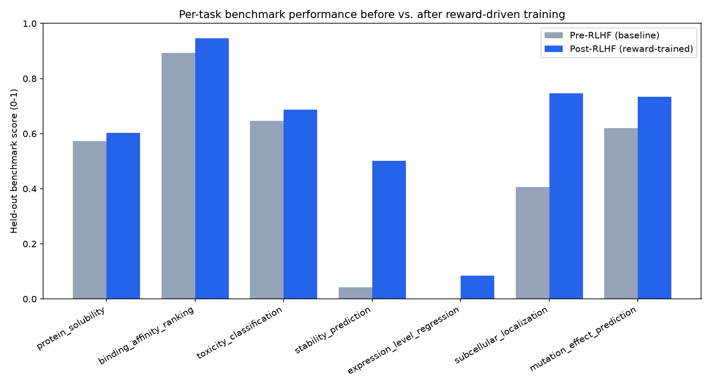
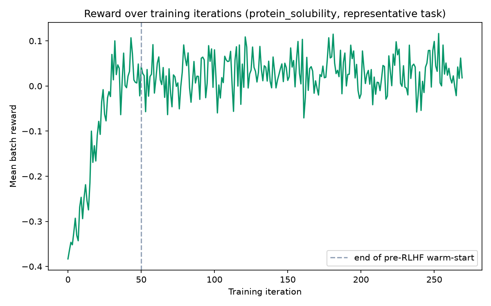

# BioRewardSignalDesign -- Run Report

Real numbers from an actual run of `run_all.py`. See README.md for the full project description, reward-signal design rationale, and honest scope notes.

## Per-task results (held-out benchmark)

| Task | Type | Before | After | Relative improvement |
|---|---|---|---|---|
| protein_solubility | regression | 0.574 | 0.602 | +5.0% |
| binding_affinity_ranking | binary | 0.893 | 0.947 | +6.0% |
| toxicity_classification | binary | 0.647 | 0.687 | +6.2% |
| stability_prediction | regression | 0.042 | 0.501 | +917.3% |
| expression_level_regression | regression | 0.000 | 0.085 | +169.6% |
| subcellular_localization | multiclass | 0.407 | 0.747 | +83.6% |
| mutation_effect_prediction | multiclass | 0.620 | 0.733 | +18.3% |

**Mean score before:** 0.455  
**Mean score after:** 0.614  
**Aggregate relative improvement across 7 tasks: +35.1%**

## Figures

